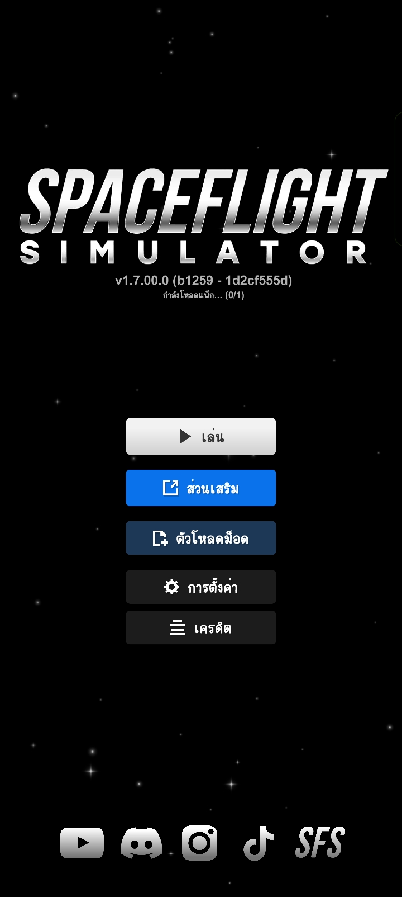
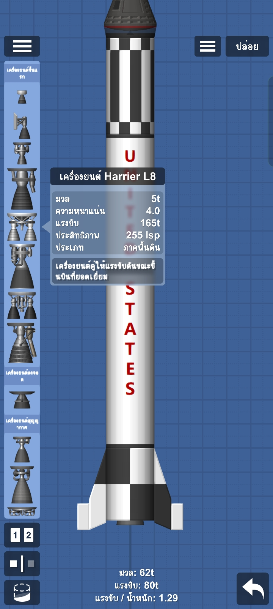
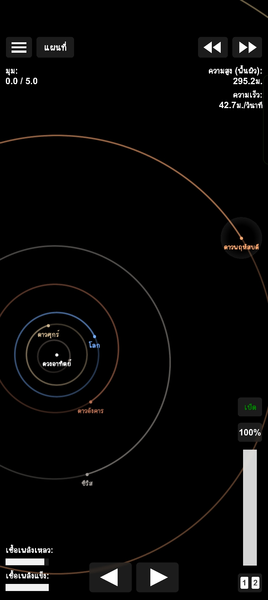
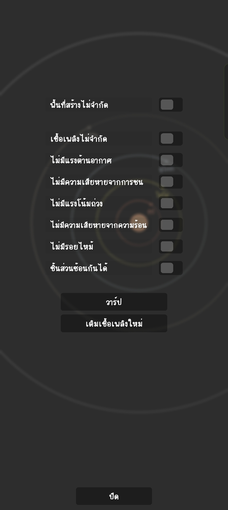

# SFS-TH-Translate
มอด SpaceFlight Simulator แปลไทย ครบ 100% ทั้ง ตัวเต็ม/Beta
มอดรองรับ Android/Steam (IOSไม่รองรับเพราะคนทำไม่มีสินค้าแบรนด์ผลไม้)
มอดนี่แปลทุกข้อความที่ควรแปลและจะใช้ภาษาอังกฤษในบางอย่าเช่น RCS หรือชื่อชิ้นส่วนบางตัว รวมถึงการทับศัพย์อย่าง พลูโต เอนเซลาดัส มิแรนด้า บลาๆ
ทั้งนี้ยังจะอัพเดทต่อเนื่องจนกว่าคนทำทอดจะเบื่อเกมแล้วหนีไปเล่น GTA VI แต่ไม่ต้องห่วงเพราะคนทำรักเกมนี้สุดหรงใจและจะแปลไปอีกนานเลย
___
## ตัวอย่างงานแปลในเกม
</img>
</img>
</img>
</img>
</img>
</img>
___
## วิธีลงมอดในมือถือ
1. โหลดไฟล์มาจะไปอยู่ในโฟลเดอร์ download
</img>

2. เข้าไปในโฟลเดอร์และกด "คัดลอก" หรือ "ตัด" และกลับไปยังโฟลเดอร์ก่อนหน้า
</img>

3. จากนั้นเข้าไปยังโฟลเดอร์ Android และเข้าไปยังโฟลเดอร์ Midia
</img>

4. เมื่อเข้า Media มาแล้วให้หาโฟลเดอร์เกมและเข้าไป
</img>

5.เมื่อเข้าโฟลเดอร์เกมมาแล้วจะสังเกตุเห็นโฟลเดอร์ Custom translate
</img>

แค่เข้าโฟลเดอร์นั้นและกดวางไฟล์ที่เอามาก็เสร็จแล้ว หลังจากลงเสร็จให้เข้าตั้งค่าในเกมและดูในเปลี่ยนภาษาว่ามีภาษาไทยไหมถ้ามีก็เอนจอยครับ

# Authorship & Credits

* </img> **Luna Tomato**
  * [GitHub Profile](https://github.com/tomato9946) | [YouTube Channel](https://www.youtube.com/channel/UCv2v5wErevqbt4HJkFUhe2A) | [Spaceflight Simulator Thailand Discord](https://discord.gg/SfTGQAhJJP) | [Forums Profile](https://sfsforum.com/index.php?members/rotten-tomato.26818/)
